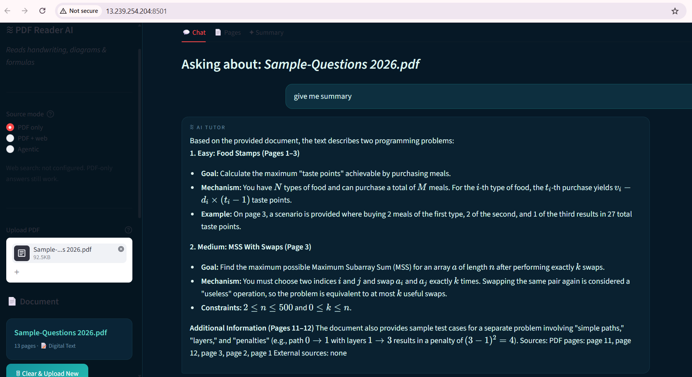
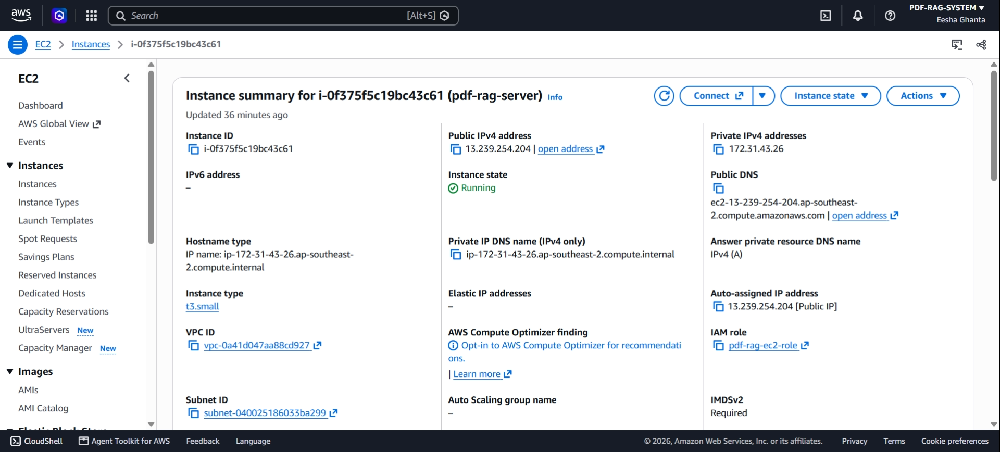
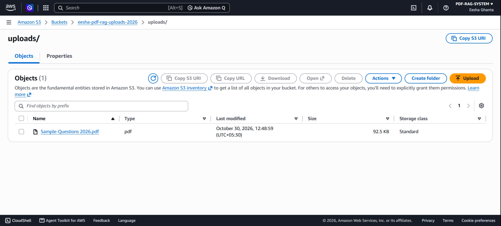

# PDF Reader AI

A Streamlit app that answers questions about typed, scanned, and handwritten PDFs. Digital pages are chunked and retrieved with local FastEmbed vectors. Scanned pages are rendered with PyMuPDF and read by Gemini, using the retrieved pages rather than the first four pages of the file.

PDF-only retrieval remains the default. External web search and an agent mode are optional.

## Architecture

1. Upload a PDF. PyPDF2 extracts text. If that text is almost empty, the file is treated as scanned.
2. Digital text is split by page so a citation stays on the page it came from. FastEmbed (`BAAI/bge-small-en-v1.5`) ranks chunks by cosine similarity.
3. Screenshot pages inside an otherwise digital PDF, and fully scanned PDFs, are transcribed before retrieval and the selected page images are sent to Gemini.
4. Source mode controls evidence:
   - **PDF only** uses the document and never calls web search.
   - **PDF + web** searches only when the best PDF score is below 0.45.
   - **Agentic** does the same search decision, retries PDF retrieval once with a wider candidate set, and abstains when neither source supports an answer.
5. Answers cite PDF page numbers and, when used, external titles and URLs. PDF evidence and web evidence stay separate. Disagreements are reported instead of being silently merged. General model knowledge is not treated as verified evidence.

Gold evaluation answers are never sent to answer generation. The judge sees a reference answer only after the model answer exists.

## Setup

```bash
cd pdf-rag-system
python -m venv .venv
.venv\Scripts\activate
python -m pip install -r requirements.txt
copy .env.example .env
```

Put your Gemini key in `.env`:

```bash
GEMINI_API_KEY=your-key-here
```

Start the app:

```bash
python -m streamlit run app.py
```

Example questions after uploading a PDF:

- What storage allocation strategies does the document describe?
- What is on page 12?
- Is the pilot-test size stated in this document?

## Docker

```bash
docker build -t pdf-rag-system .
docker run -p 8501:8501 --env-file .env pdf-rag-system
```

Open http://localhost:8501. The `.env` file is kept out of the image by `.dockerignore`.

## AWS deployment

The app was deployed on AWS as a learning project.

- **EC2** (t3.small, Amazon Linux 2023) runs the Docker container.
- **S3** stores uploaded PDFs under `uploads/`. Set the `S3_BUCKET` and `AWS_REGION` environment variables to turn it on. If `S3_BUCKET` is not set, the app works exactly as before.
- **IAM role** attached to the instance gives it access to one bucket, with only `PutObject`, `GetObject`, and `ListBucket`. No AWS keys are stored on the server or in the repo.
- **Security group** allows SSH and port 8501 from a single IP address only.





Known limits:

- The app saves uploads to S3 but does not load them back from S3.
- It is served over plain HTTP on one instance, with no HTTPS or load balancer.
- It was a short test deployment, and the AWS resources have since been shut down.

## External search

Web search is off unless one of these is set:

```bash
TAVILY_API_KEY=
BRAVE_SEARCH_API_KEY=
```

Tavily is used when its key is present. Otherwise Brave Search is used. If neither key is set, PDF-only mode still works, and the web modes say that search is not configured. Keys are read from the environment and are not written into answers or logs.

## Evaluation

The checked-in `evals/results.json` file is the baseline PDF-only run. New runs write a different file unless you explicitly choose the baseline name.

```bash
python -m unittest tests.test_rag_core
python -m py_compile app.py ai_engine.py utils.py pdf_rag.py web_search.py evals/run_evals.py
python evals/run_evals.py --output results_improved.json
python evals/compare_modes.py
```

`evals/run_evals.py` checks that all 39 questions name a PDF in `evals/docs/`. It records correctness, groundedness, page-hit rate, abstention on unanswerable questions, latency, API errors, and token counts when Gemini returns usage metadata. Page-hit rate uses only questions that have a numeric PDF page. Questions with `page: null` are excluded from that denominator.

The comparison report is `evals/comparison_report.md`. Agentic output is `evals/results_agentic.json`.

## Tests

`tests/test_rag_core.py` covers:

- all 39 questions and their PDF files
- page-hit rules
- a supported fact versus an incorrect answer
- an unsupported extra claim
- abstention for unanswerable questions
- page citations and the source footer
- proof that a reference answer is not inserted into the evidence prompt
- retrieval ranking
- scanned fallback pages spread across the file
- web search staying unavailable without credentials

## Limitations

- Scanned documents are transcribed on first use. A long scan takes one Gemini call per page, then retrieval is local.
- Summaries of scanned files use a spread of pages, not every page.
- Web search adds only a few snippets, and only after PDF retrieval looks weak.
- The agent retries retrieval once. It does not run an open-ended tool loop.
- Gemini token counts are reported when the response includes them. The API does not return a dollar cost.
- Page-hit rate is not a score over all 39 questions. Mini-project items that only have a printed page are outside that rate.
- Evaluation quality still depends on the Gemini judge. A matching reference fact should not excuse an unsupported extra claim, and the judge is instructed that way.

## Stack

| Layer | Tool |
|---|---|
| UI | Streamlit |
| PDF text | PyPDF2 |
| PDF rendering | PyMuPDF |
| Retrieval | FastEmbed and cosine similarity |
| LLM | Gemini (`gemini-3.1-flash-lite`) |
| Optional search | Tavily or Brave Search |
| Config | python-dotenv |
